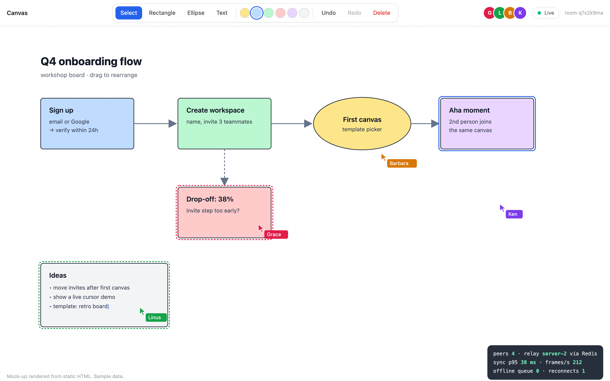
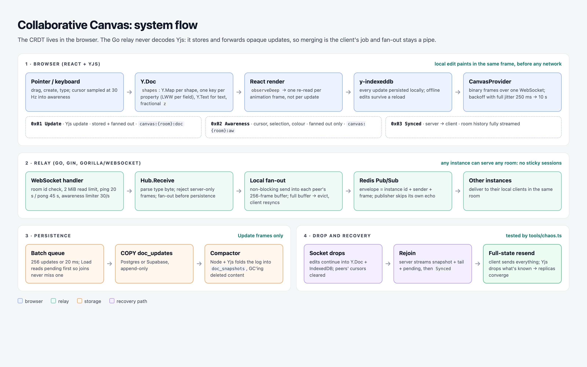
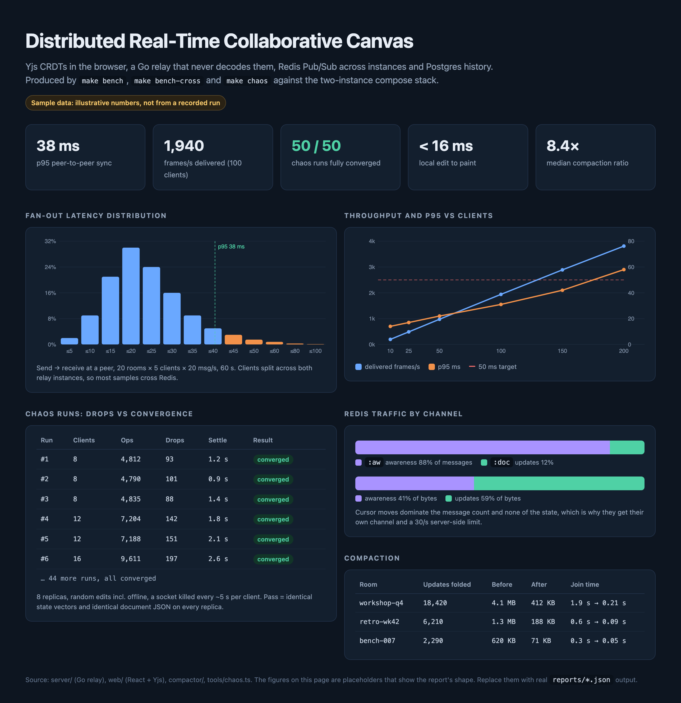

# Distributed Real-Time Collaborative Canvas

A multi-user vector canvas: shapes, text and live cursors, edited by many people at once with no locks and no lost edits.



> **Status:** code complete, not yet run end to end. Unit tests pass (Go hub and protocol under `-race`; Yjs convergence in Vitest), and all three TypeScript packages typecheck. The images in `reports/` are mock-ups with sample numbers. `make bench` and `make chaos` produce the real ones.

## How it works



**The CRDT lives in the browser.** Each shape is a `Y.Map` with one key per property, so two people moving and recolouring the same shape both win (last writer wins per property, not per shape). Text is a `Y.Text`, so concurrent typing interleaves. z-order is a fractional number with an id tie-break, so every peer renders the same stack.

**The server never decodes Yjs.** Yjs updates are commutative and idempotent, so the Go relay only has to store and forward opaque bytes. It doesn't merge anything. That keeps the hot path a pipe and keeps all conflict logic in one language.

**Three frame types** (one type byte + payload):

| Byte | Frame | Persisted | Redis channel |
|---|---|---|---|
| `0x01` | Yjs update | yes | `canvas:{room}:doc` |
| `0x02` | awareness (cursor, selection, colour) | **no** | `canvas:{room}:aw` |
| `0x03` | synced (server → client) | n/a | n/a |

Cursor moves are most of the messages and none of the state. They're throttled to 30/s on both client and server, never written to Postgres, and get their own Redis channel.

**Fan-out never waits on a slow client.** Each connection has a 256-frame send buffer. If it fills, that client is evicted and resyncs on reconnect, and nobody else in the room is slowed down.

**Any instance serves any room.** Instances share Redis Pub/Sub. Each message carries the publishing instance's id, so an instance skips its own echo. No sticky sessions.

**Recovery after a drop.** Edits keep landing in the local `Y.Doc` and IndexedDB while offline. On reconnect the server streams the room's history (latest snapshot, later updates, anything not yet flushed), then sends `Synced`. The client then sends its entire state, and Yjs discards what the server already has. That is the "100% state recovery" guarantee, and `tools/chaos.ts` tests it.

**Persistence is off the latency path.** Updates are batched (256 or 20 ms) into a Postgres `COPY`. A join reads the pending queue *before* the database, so an update that is in flight is seen twice, never zero times. The Node compactor folds each room's log into one garbage-collected snapshot so join time doesn't grow forever.

## Run it

```bash
make up          # 2 relays + Redis + Postgres + compactor + web on http://localhost:8088
make dev         # or: relay in memory mode + Vite on :5173, no Docker
make test        # go test -race + vitest
make bench       # fan-out latency/throughput → reports/bench.json
make chaos       # random disconnects, then assert all replicas identical → reports/chaos.json
```

Open the same `?room=` URL in two browsers. They'll often land on different relay instances, and they still see each other.

Supabase works as the Postgres: set `DATABASE_URL` to its connection string and run `sql/schema.sql`. The web build deploys to Vercel as static files, with `VITE_WS_URL` pointing at the relay.

## Targets

| | Target | How it's measured |
|---|---|---|
| Local edit → paint | < 50 ms | applied to the Y.Doc and rendered in the same animation frame |
| Peer-to-peer sync, p95 | < 50 ms | `cmd/loadtest`: send→receive timestamps across instances |
| Throughput | 1,000+ msgs/s | `cmd/loadtest`: 20 rooms × 5 clients × 20 msg/s |
| Recovery after drop | 100% | `tools/chaos.ts`: identical state vectors + document JSON on every replica |



## Layout

```
server/                  Go relay
  internal/protocol      frame types, parse/encode
  internal/hub           rooms, non-blocking fan-out, slow-client eviction, bus bridge
  internal/bus           Redis Pub/Sub, doc/awareness channel split
  internal/store         Postgres: batched COPY, snapshot + tail load
  internal/ws            Gin WebSocket handler, ping/pong, awareness rate limit
  cmd/server             main
  cmd/loadtest           latency + throughput benchmark
web/                     React + Vite + Tailwind + Yjs
  src/lib/schema.ts      document layout and edit operations
  src/lib/provider.ts    WebSocket provider: sync, offline, backoff
  src/hooks/useCanvas.ts Y.Doc + IndexedDB + awareness → React state
compactor/               Node + Yjs: fold update log into snapshots
tools/chaos.ts           convergence under random connection drops
sql/schema.sql
```

## Choices worth defending

- **Plain WebSockets, not Socket.IO.** The payloads are binary Yjs updates. Socket.IO's event framing and fallbacks add bytes and a dependency on both sides for nothing this needs.
- **No Yjs on the server.** The trade-off is that the server can't compute a diff for a reconnecting client, so the client sends its full state. That costs bandwidth on reconnect, and the compactor keeps it bounded.
- **Evict instead of buffer.** An unbounded per-client queue turns one slow client into server memory growth. Evicting costs that one client a resync.

## Stretch goals

WebRTC data channels for peer-to-peer awareness (the relay stays authoritative for state). An undo/redo history tree beyond `Y.UndoManager`'s linear stack. SVG/PNG export.
